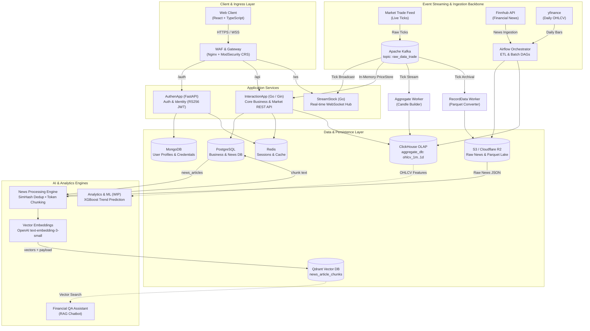
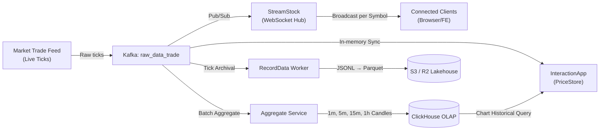
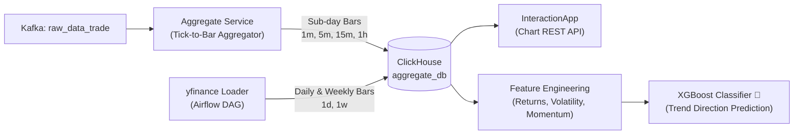

# Kstock: Real-Time Financial Market Platform & AI Intelligence

A distributed stock-market data and analytics platform built on an **Event-Driven** architecture. It combines a real-time market data pipeline (**Kafka → WebSocket/REST API**), multi-timeframe **OHLCV candle analytics (ClickHouse)**, an **XGBoost** trend-prediction model, and an intelligent **Financial RAG Chatbot** for financial question answering.

---

## Table of Contents

- [System Architecture Overview](#system-architecture-overview)
- [Monorepo Structure](#monorepo-structure)
- [Technology Stack](#technology-stack)
- [Core Data Processing Flows](#core-data-processing-flows)
  - [1. Real-Time Market Data Pipeline](#1-real-time-market-data-pipeline)
  - [2. OHLCV Candle Aggregation & ML Analytics](#2-ohlcv-candle-aggregation--ml-analytics)
  - [3. Financial News Ingestion & RAG Intelligence Pipeline](#3-financial-news-ingestion--rag-intelligence-pipeline)
- [Security & Operational Characteristics](#security--operational-characteristics)
- [Deployment Guide](#deployment-guide)
  - [Port Mappings](#port-mappings)
  - [Launching the System](#launching-the-system)
- [License](#license)

---

## System Architecture Overview



---

## Monorepo Structure

The system is organized as a monorepo with clear responsibility boundaries for each microservice:

```text
Kstock/
├── AuthenApp/          # Identity Provider & User Auth (FastAPI, RS256 JWT, OAuth2, MongoDB, Redis)
├── InteractionApp/     # Core Business API & Market REST Endpoints (Go, Gin, PostgreSQL, ClickHouse)
├── StreamStock/        # Real-time WebSocket Gateway (Go, Gorilla WebSocket, Kafka Consumer)
├── FE/                 # Financial Web Dashboard (React, TypeScript, Tailwind)
├── NewsIngester/       # Pulls financial news from Finnhub into Cloud Storage (Python, Boto3)
├── NewsProcesing/      # NLP Pipeline: Dedup (SimHash), Chunking & Qdrant Vector Store
├── airflow/            # Orchestration DAGs for Batch News Ingestion, Embedding & Tick Archival
├── nginx/              # Reverse Proxy & Web Application Firewall (ModSecurity Core Rule Set)
├── utils/
│   ├── Aggregate/      # Real-time sub-day OHLCV candle aggregation engine (Kafka → ClickHouse)
│   ├── RecordData/     # Raw tick compression & archival worker (Kafka → JSONL → Parquet → S3)
│   └── CollectData/    # Utility tools for market data collection
└── infrastructure/     # Terraform IaC for Cloud infrastructure (GCP Compute, VPC, NAT, Firewalls)
```

---

## Technology Stack

| Architecture Layer | Core Technologies | Engineering Role |
|--------------------|-------------------|------------------|
| **Frontend** | React 18, TypeScript, TailwindCSS | Dashboard UI for charts, news, and user interactions |
| **Gateway & WAF** | Nginx LTS, OWASP ModSecurity CRS | Reverse proxy, rate limiting, SSL termination, and OWASP Top 10 defense |
| **Core Services** | Go 1.25+ (Gin, Gorilla WebSocket)<br>Python 3.12+ (FastAPI, Beanie ODM) | REST API business logic, low-latency WebSocket streaming, JWT issuance |
| **Event Streaming** | Apache Kafka | Backbone for real-time market tick distribution (`raw_data_trade`) |
| **OLAP & Time-Series** | ClickHouse (`MergeTree` engine) | Storage and analytical queries over billions of multi-timeframe OHLCV candles |
| **Relational Database** | PostgreSQL 13 | Business data (favorites, alerts, transactions) and news articles |
| **Document Store & Cache** | MongoDB, Redis (LRU 512MB) | User profiles, Refresh Token management, Sessions, and transient cache |
| **Data Lake & Storage** | AWS S3 / Cloudflare R2, Apache Parquet | Compressed Parquet raw ticks and raw news JSON |
| **AI / NLP & RAG** | OpenAI Embeddings, Qdrant, SimHash, LangChain, TikToken | News deduplication, semantic chunking, vector storage, and RAG retrieval for the Chatbot |
| **Machine Learning** | XGBoost, Scikit-learn, Pandas (WIP) | Feature engineering from OHLCV candles and market trend classification |
| **Orchestration & DevOps** | Apache Airflow, Docker Compose, Terraform, GitHub Actions | Scheduled pipeline orchestration, containerization, and CI/CD automation |

---

## Core Data Processing Flows

### 1. Real-Time Market Data Pipeline

Processes market data from the live tick feed with low latency and high throughput:



- **Message Routing**: The Kafka partition key is the `symbol`, guaranteeing chronological ordering per ticker.
- **WebSocket Broadcast**: Clients subscribe per symbol (`{"type": "subscribe", "symbol": "AAPL"}`). StreamStock uses a non-blocking pub/sub model with backpressure (a 256-message ring buffer per client) to automatically drop slow connections without stalling the whole system.
- **In-Memory Store**: `InteractionApp` keeps `PriceStore` and `DailyCloseStore` in RAM to serve current-price endpoints instantly without putting pressure on the database.

---

### 2. OHLCV Candle Aggregation & ML Analytics

Computes and aggregates multi-timeframe candles for technical charting and machine-learning training:



- **Sub-day Aggregation**: The `Aggregate` worker continuously consumes ticks from Kafka, builds candles for the `1m`, `5m`, `15m`, and `1h` windows, and batch-writes them directly to ClickHouse.
- **Daily / Weekly Sync**: Daily (`1d`) and weekly (`1w`) candles are synced periodically via an Airflow DAG combined with `yfinance`.
- **Machine Learning (WIP)**:
  - Extracts technical features from ClickHouse (rolling returns, volatility, momentum, volume distribution).
  - Trains an **XGBoost** classification model to predict the price trend (up/down) of the next trading session.

---

### 3. Financial News Ingestion & RAG Intelligence Pipeline

Collects, refines, and vectorizes knowledge from financial news to power the RAG question-answering assistant:

```mermaid
flowchart LR
    Finn["Finnhub API\n(Company News)"] --> Ingest["NewsIngester /\nAirflow DAG"]
    Ingest -->|Raw JSON| S3[("S3 / R2 Object Storage\nnews_raw/src=finnhub/...")]
    
    S3 --> Crawl["Content Crawler\n(Trafilatura HTML Extraction)"]
    Crawl -->|UPSERT| PG_Art[("PostgreSQL\nnews_articles")]
    
    PG_Art --> Cleaner["Text Normalization\n(NFKC & Cleaning)"]
    Cleaner --> SimHash["SimHash Dedup\n(Hamming ≤ 3 + DSU)"]
    SimHash --> Chunker["Semantic Chunker\n(tiktoken ~450 tokens)"]
    Chunker -->|chunk text| PG_Chunk[("PostgreSQL\narticle_chunks")]
    Chunker --> Embed["OpenAI Embeddings\n(text-embedding-3-small)"]
    Embed -->|vectors + payload| QDRANT[("Qdrant\nnews_article_chunks")]
    
    PG_Chunk -.->|chunk id| QDRANT
    QDRANT -.->|Vector Search| Chat["Financial Chatbot\n(RAG QA Assistant)"]
```



#### Detailed Processing Steps:
1. **Ingestion**: The Airflow DAG (`upload_news`) periodically pulls news from Finnhub per symbol and stores it as raw JSON on S3/R2 (`news_raw/src=finnhub/<symbol>/<date>.json`).
2. **Content Extraction**: Downloads the raw JSON, extracts the full article body with `trafilatura`, and `UPSERT`s it into the `news_articles` table.
3. **Near-Duplicate Detection**:
   - Normalizes the text (`NFKC`) and generates a **64-bit SimHash** fingerprint.
   - Uses block partitioning for extremely fast Hamming-distance lookups.
   - Clusters similar articles (Hamming distance $\le 3$) with a **Disjoint Set Union (Union-Find)** structure, keeping only the earliest-published article.
4. **Token-Aware Chunking**:
   - Splits text by heading structure (`HTMLHeaderTextSplitter`) combined with `RecursiveCharacterTextSplitter`.
   - Caps chunk size at roughly **450 tokens** using the `tiktoken` `cl100k_base` encoding.
   - Enriches each chunk with metadata: `article_id`, `title`, `source`, `published_at`, `symbol`, `url`, `section`, `chunk_index`, `token_count`.
5. **Relational Chunk Storage**: Persists the chunk **text** into the PostgreSQL `article_chunks` table (`article_id`, `chunk_index`, `content`, `token_count`) and returns the generated chunk ids. Existing chunks of the same articles are replaced first, so re-running the pipeline stays idempotent.
6. **Vectorization & Vector Store**:
   - Embeds each chunk in batches (100 chunks) with `text-embedding-3-small` (1536 dimensions).
   - Upserts the vectors into **Qdrant** (collection `news_article_chunks`, Cosine distance).
   - Each point is keyed by the PostgreSQL `article_chunks.id` (with a deterministic UUID fallback), so vectors can always be joined back to the relational chunk rows.
   - The point payload mirrors the chunk metadata (`article_id`, `section`, `title`, `source`, `symbol`, `url`, `published_at`, and optionally `content`) to support filtered retrieval by symbol/article.
   - If Qdrant is unavailable, the pipeline keeps the stored chunk text and reports a non-fatal `vector_error`; pass `--skip-vectors` to skip embeddings entirely.
7. **Intelligent QA (RAG Chatbot)**:
   - When a user asks about a ticker, the system embeds the query, searches the nearest chunks in Qdrant (optionally filtered by `symbol`/`article_id`), and combines them with market metrics to produce accurate, hallucination-resistant answers.

#### NewsProcesing environment variables

| Variable | Purpose |
|----------|---------|
| `DATABASE_URL` (or `POSTGRES_HOST`, `POSTGRES_PORT`, `POSTGRES_DB`, `POSTGRES_USER`, `POSTGRES_PASSWORD`) | PostgreSQL connection used to read `news_articles` and write `article_chunks` |
| `OPENAI_API_KEY` | Generates embeddings with `text-embedding-3-small` |
| `QDRANT_URL` | Qdrant endpoint, e.g. `http://localhost:6333` |
| `QDRANT_API_KEY` | API key (required by Qdrant Cloud, optional for a local server) |
| `QDRANT_COLLECTION` | Target collection name (default: `news_article_chunks`) |

---

## Security & Operational Characteristics

- **Asymmetric Authentication (RS256 / JWK)**:
  - `AuthenApp` uses an RSA asymmetric key pair (`private.pem` to sign JWTs, `public.pem` published via a JWK endpoint).
  - `InteractionApp` (Go) verifies token signatures independently with the public key, with no callback to the auth service — eliminating a central bottleneck.
- **Web Application Firewall (WAF)**:
  - OWASP ModSecurity Core Rule Set (CRS) integrated at the Nginx gateway.
  - Paranoia Level 1 for comprehensive protection against SQL Injection, XSS, RCE, and malicious scanning behavior.
- **Session Management & Token Revocation**:
  - Refresh Tokens and Session IDs are managed in Redis with automatic TTL expiry and instant revocation when a user logs out.
- **High Concurrency & Low Latency**:
  - Uses `sync.RWMutex` and goroutines in Go for safe in-memory reads/writes of market data.
  - Separate Kafka consumer groups per task: WebSocket Hub, Aggregation, and Data Archival.

---

## Deployment Guide

### Port Mappings

| Component | Container Port | Host Port | Purpose |
|-----------|----------------|-----------|---------|
| **WAF (Nginx + ModSecurity)** | 8080 / 8443 | `80` / `443` | Single entry point accepting HTTP/HTTPS from users |
| **AuthenApp** | 8000 | `8000` | FastAPI Auth & User Management |
| **InteractionApp** | 8080 | `8080` | Core Go REST API |
| **StreamStock** | 8080 | `8080` | WebSocket Real-time Market Data Hub |
| **PostgreSQL** | 5432 | `5432` | Relational Business & News Database |
| **Redis** | 6379 | `6379` | Token Session & In-memory Cache |
| **ClickHouse** | 8123 / 9000 | `8123` / `9000` | HTTP Interface & Native TCP Client |
| **Kafka (Broker)** | 9092 | `29092` | Event Message Broker |

---

### Launching the System

#### 1. Prepare the Environment

Make sure **Docker** and **Docker Compose** are installed, and configure the environment files:

```bash
# Set up the environment configuration for the services
cp AuthenApp/.env.example AuthenApp/.env
cp InteractionApp/.env.example InteractionApp/.env
```

#### 2. Start the Data & Storage Layer

Start PostgreSQL, Redis, ClickHouse, and the tick aggregation service:

```bash
docker compose -f docker-compose.yml up -d
```

#### 3. Start the Application & Gateway Layer

Start the Web Application Firewall, AuthenApp, and InteractionApp:

```bash
docker compose -f compose.auth.yaml up -d
```

#### 4. Run the News Processing Pipeline (News NLP & Embedding)

Run the news processing pipeline for a specific symbol:

```bash
cd NewsProcesing

# Install dependencies (via uv or pip)
uv sync

# Run the flow: Dedup → Chunk → Generate Embeddings
python pipeline.py --symbol AAPL --date 2026-10-14 --threshold 3
```

---

## License

This project is distributed under an open-source license. See the [LICENSE](LICENSE) file for details.
