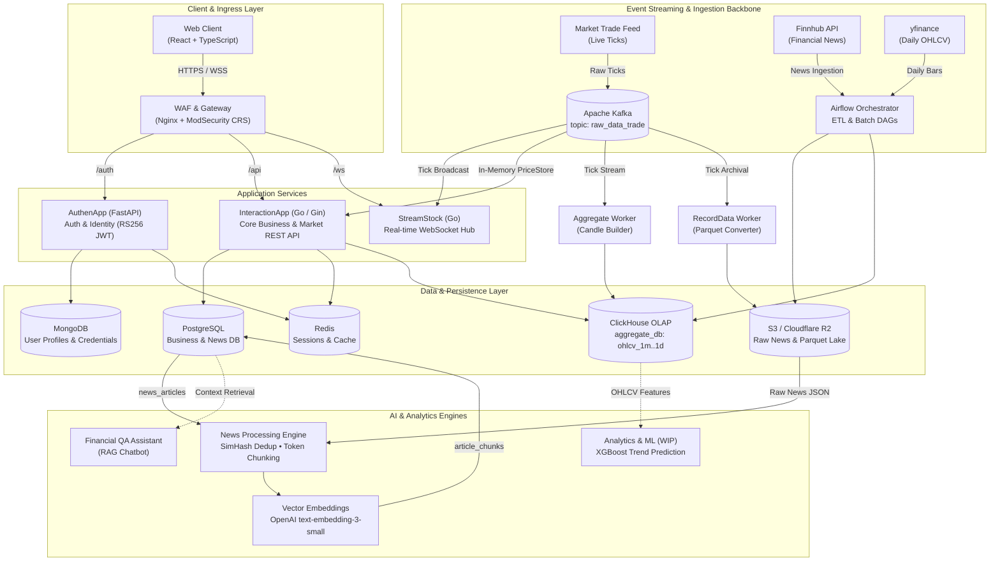
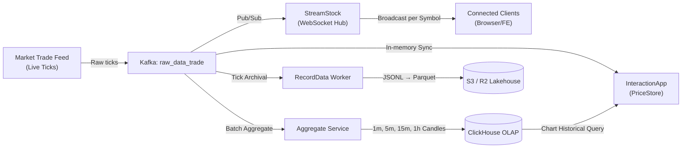
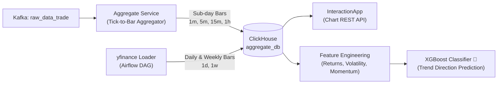

# Kstock: Real-Time Financial Market Platform & AI Intelligence

Hệ thống phân tích và xử lý dữ liệu chứng khoán phân tán theo kiến trúc **Event-Driven**, tích hợp luồng dữ liệu thời gian thực (**Kafka → WebSocket/REST API**), lưu trữ phân tích nến **OHLCV đa khung thời gian (ClickHouse)**, mô hình học máy **XGBoost dự đoán xu hướng**, và trợ lý hỏi đáp tài chính thông minh (**Financial RAG Chatbot**).

---

## Mục lục

- [Kiến trúc hệ thống tổng quan](#kiến-trúc-hệ-thống-tổng-quan)
- [Cấu trúc Monorepo](#cấu-trúc-monorepo)
- [Technology Stack](#technology-stack)
- [Các luồng xử lý dữ liệu cốt lõi](#các-luồng-xử-lý-dữ-liệu-cốt-lõi)
  - [1. Real-Time Market Data Pipeline](#1-real-time-market-data-pipeline)
  - [2. OHLCV Candle Aggregation & ML Analytics](#2-ohlcv-candle-aggregation--ml-analytics)
  - [3. Financial News Ingestion & RAG Intelligence Pipeline](#3-financial-news-ingestion--rag-intelligence-pipeline)
- [Bảo mật & Đặc tính vận hành](#bảo-mật--đặc-tính-vận-hành)
- [Hướng dẫn triển khai (Deployment)](#hướng-dẫn-triển-khai-deployment)
  - [Bảng ánh xạ cổng (Port Mappings)](#bảng-ánh-xạ-cổng-port-mappings)
  - [Khởi chạy hệ thống](#khởi-chạy-hệ-thống)
- [License](#license)

---

## Kiến trúc hệ thống tổng quan



---

## Cấu trúc Monorepo

Hệ thống được tổ chức dạng monorepo với ranh giới trách nhiệm rõ ràng cho từng microservice:

```text
Kstock/
├── AuthenApp/          # Identity Provider & User Auth (FastAPI, RS256 JWT, OAuth2, MongoDB, Redis)
├── InteractionApp/     # Core Business API & Market REST Endpoints (Go, Gin, PostgreSQL, ClickHouse)
├── StreamStock/        # Real-time WebSocket Gateway (Go, Gorilla WebSocket, Kafka Consumer)
├── FE/                 # Financial Web Dashboard (React, TypeScript, Tailwind)
├── NewsIngester/       # Ingestion kéo tin tức tài chính Finnhub về Cloud Storage (Python, Boto3)
├── NewsProcesing/      # NLP Pipeline: Khử trùng lặp (SimHash), Token Chunking & Vector Embeddings
├── airflow/            # Orchestration DAGs cho Batch News Ingestion, Embedding & Tick Archival
├── nginx/              # Reverse Proxy & Web Application Firewall (ModSecurity Core Rule Set)
├── utils/
│   ├── Aggregate/      # Engine tổng hợp nến OHLCV sub-day thời gian thực (Kafka → ClickHouse)
│   ├── RecordData/     # Worker nén và lưu trữ raw tick (Kafka → JSONL → Parquet → S3)
│   └── CollectData/    # Utility tools phục vụ thu thập dữ liệu thị trường
└── infrastructure/     # Terraform IaC quản lý hạ tầng Cloud (GCP Compute, VPC, NAT, Firewalls)
```

---

## Technology Stack

| Tầng kiến trúc | Công nghệ chính | Vai trò kỹ thuật |
|----------------|-----------------|------------------|
| **Frontend** | React 18, TypeScript, TailwindCSS | Giao diện dashboard theo dõi biểu đồ, tin tức và tương tác người dùng |
| **Gateway & WAF** | Nginx LTS, OWASP ModSecurity CRS | Reverse proxy, rate limiting, SSL termination và phòng vệ OWASP Top 10 |
| **Core Services** | Go 1.25+ (Gin, Gorilla WebSocket)<br>Python 3.12+ (FastAPI, Beanie ODM) | Xử lý nghiệp vụ REST API, streaming WebSocket độ trễ thấp, cấp phát JWT |
| **Event Streaming** | Apache Kafka | Trục xương sống phân phối tick thị trường thời gian thực (`raw_data_trade`) |
| **OLAP & Time-Series** | ClickHouse (`MergeTree` Engine) | Lưu trữ và truy vấn phân tích hàng tỷ nến OHLCV đa khung thời gian |
| **Relational Database** | PostgreSQL 13 | Lưu trữ nghiệp vụ (danh mục yêu thích, cảnh báo, giao dịch) và bài báo tin tức |
| **Document & Cache** | MongoDB, Redis (LRU 512MB) | Lưu trữ hồ sơ người dùng, quản lý Refresh Token, Session và cache tạm |
| **Data Lake & Storage** | AWS S3 / Cloudflare R2, Apache Parquet | Lưu trữ raw tick nén dạng Parquet và raw JSON tin tức |
| **AI / NLP & RAG** | OpenAI Embeddings, SimHash, LangChain, TikToken | Khử trùng lặp tin tức, phân mảnh ngữ nghĩa và truy vấn RAG cho Chatbot |
| **Machine Learning** | XGBoost, Scikit-learn, Pandas (WIP) | Feature engineering từ nến OHLCV và phân loại dự đoán xu hướng thị trường |
| **Orchestration & DevOps**| Apache Airflow, Docker Compose, Terraform, GitHub Actions | Điều phối pipeline định kỳ, đóng gói container và tự động hóa CI/CD |

---

## Các luồng xử lý dữ liệu cốt lõi

### 1. Real-Time Market Data Pipeline

Luồng xử lý dữ liệu thị trường từ nguồn cấp tick trực tiếp, đảm bảo độ trễ thấp và khả năng chịu tải cao:



- **Message Routing**: Kafka partition key theo `symbol` đảm bảo thứ tự thời gian cho từng mã cổ phiếu.
- **WebSocket Broadcast**: Client đăng ký nhận dữ liệu theo mã (`{"type": "subscribe", "symbol": "AAPL"}`). StreamStock dùng mô hình pub/sub non-blocking với cơ chế backpressure (ring buffer 256 messages/client) để tự động ngắt các kết nối chậm mà không nghẽn toàn hệ thống.
- **In-Memory Store**: `InteractionApp` duy trì cấu trúc `PriceStore` và `DailyCloseStore` trong RAM để phục vụ tức thì các endpoint truy vấn giá hiện tại mà không gây áp lực lên cơ sở dữ liệu.

---

### 2. OHLCV Candle Aggregation & ML Analytics

Pipeline tính toán và tổng hợp nến đa khung thời gian phục vụ hiển thị biểu đồ kỹ thuật và huấn luyện mô hình học máy:



- **Sub-day Aggregation**: Worker `Aggregate` liên tục tiêu thụ tick từ Kafka, dựng nến theo các cửa sổ thời gian `1m`, `5m`, `15m`, `1h` và ghi batch trực tiếp vào ClickHouse.
- **Daily / Weekly Sync**: Nến ngày (`1d`) và nến tuần (`1w`) được đồng bộ lịch sử định kỳ thông qua Airflow DAG kết hợp cùng `yfinance`.
- **Machine Learning (WIP)**: 
  - Khai thác đặc trưng kỹ thuật từ ClickHouse (tỷ suất sinh lời rolling, độ biến động volatility, chỉ số xung lượng momentum, phân bố khối lượng).
  - Huấn luyện mô hình phân loại **XGBoost** để dự đoán xu hướng giá (tăng/giảm) trong phiên giao dịch kế tiếp.

---

### 3. Financial News Ingestion & RAG Intelligence Pipeline

Quy trình thu thập, tinh lọc và số hóa tri thức từ tin tức tài chính phục vụ trợ lý ảo hỏi đáp (RAG):

```mermaid
flowchart LR
    Finn["Finnhub API\n(Company News)"] --> Ingest["NewsIngester /\nAirflow DAG"]
    Ingest -->|Raw JSON| S3[("S3 / R2 Object Storage\nnews_raw/src=finnhub/...")]
    
    S3 --> Crawl["Content Crawler\n(Trafilatura HTML Extraction)"]
    Crawl -->|UPSERT| PG_Art[("PostgreSQL\nnews_articles")]
    
    PG_Art --> Cleaner["Text Normalization\n(NFKC & Cleaning)"]
    Cleaner --> SimHash["SimHash Dedup\n(Hamming ≤ 3 + DSU)"]
    SimHash --> Chunker["Semantic Chunker\n(tiktoken ~450 tokens)"]
    Chunker --> Embed["OpenAI Embeddings\n(text-embedding-3-small)"]
    Embed --> PG_Chunk[("PostgreSQL / VectorDB\narticle_chunks")]
    
    PG_Chunk -.->|Vector Search| Chat["Financial Chatbot\n(RAG QA Assistant)"]
```



#### Quy trình xử lý chi tiết:
1. **Thu thập (Ingestion)**: Airflow DAG (`upload_news`) định kỳ kéo tin từ Finnhub theo từng mã cổ phiếu và lưu trữ dạng raw JSON lên S3/R2 (`news_raw/src=finnhub/<symbol>/<date>.json`).
2. **Trích xuất nội dung**: Tải raw JSON, bóc tách toàn văn nội dung bài viết bằng `trafilatura` và `UPSERT` vào bảng `news_articles`.
3. **Khử trùng lặp bài báo (Near-Duplicate Detection)**:
   - Chuẩn hóa văn bản (`NFKC`), sinh mã băm ngữ nghĩa **64-bit SimHash**.
   - Sử dụng kỹ thuật Block Partitioning để truy vấn khoảng cách Hamming cực nhanh.
   - Gom cụm các bài viết tương tự (Hamming Distance $\le 3$) bằng cấu trúc dữ liệu **Disjoint Set Union (Union-Find)**, chỉ giữ lại bài viết xuất hiện sớm nhất.
4. **Phân mảnh ngữ nghĩa (Token-Aware Chunking)**:
   - Phân đoạn văn bản dựa trên cấu trúc tiêu đề (`HTMLHeaderTextSplitter`) kết hợp `RecursiveCharacterTextSplitter`.
   - Giới hạn kích thước xấp xỉ **450 tokens** theo bảng mã `cl100k_base` của `tiktoken`.
5. **Vector hóa & Lưu trữ**:
   - Vector hóa từng đoạn văn bản theo batch (100 chunks) bằng mô hình `text-embedding-3-small`.
   - Lưu trữ metadata và vector vào `article_chunks` để phục vụ truy vấn tương đồng ngữ nghĩa.
6. **Hỏi đáp thông minh (RAG Chatbot)**:
   - Khi người dùng đặt câu hỏi về một mã cổ phiếu, hệ thống trích xuất vector truy vấn, tìm kiếm các chunk tin tức liên quan nhất và kết hợp cùng chỉ số tài chính để sinh câu trả lời chính xác, tránh hallucination.

---

## Bảo mật & Đặc tính vận hành

- **Asymmetric Authentication (RS256 / JWK)**:
  - `AuthenApp` sử dụng cặp khóa bất đối xứng RSA (`private.pem` để ký JWT, `public.pem` công khai qua endpoint JWK).
  - `InteractionApp` (Go) xác thực chữ ký token độc lập bằng public key mà không cần gọi ngược về service xác thực, loại bỏ hoàn toàn điểm nghẽn tập trung.
- **Web Application Firewall (WAF)**:
  - Tích hợp OWASP ModSecurity Core Rule Set (CRS) tại cổng Nginx.
  - Thiết lập Paranoia Level 1, bảo vệ toàn diện chống SQL Injection, XSS, RCE và các hành vi dò quét độc hại.
- **Quản lý phiên & Thu hồi token**:
  - Refresh Token và Session ID được kiểm soát qua Redis với cơ chế tự động hết hạn (TTL) và thu hồi tức thì (revocation) khi người dùng đăng xuất.
- **High Concurrency & Low Latency**:
  - Tận dụng `sync.RWMutex` và Goroutines trong Go để đọc/ghi dữ liệu thị trường an toàn trong bộ nhớ.
  - Phân luồng Kafka Consumer Groups riêng biệt cho từng tác vụ: WebSocket Hub, Aggregation và Data Archival.

---

## Hướng dẫn triển khai (Deployment)

### Bảng ánh xạ cổng (Port Mappings)

| Thành phần | Cổng Container | Cổng Host | Chức năng |
|------------|----------------|-----------|-----------|
| **WAF (Nginx + ModSecurity)** | 8080 / 8443 | `80` / `443` | Cổng vào duy nhất tiếp nhận HTTP/HTTPS từ người dùng |
| **AuthenApp** | 8000 | `8000` | FastAPI Auth & User Management |
| **InteractionApp** | 8080 | `8080` | Core Go REST API |
| **StreamStock** | 8080 | `8080` | WebSocket Real-time Market Data Hub |
| **PostgreSQL** | 5432 | `5432` | Relational Business & News Database |
| **Redis** | 6379 | `6379` | Token Session & In-memory Cache |
| **ClickHouse** | 8123 / 9000 | `8123` / `9000` | HTTP Interface & Native TCP Client |
| **Kafka (Broker)** | 9092 | `29092` | Event Message Broker |

---

### Khởi chạy hệ thống

#### 1. Chuẩn bị môi trường

Đảm bảo hệ thống đã cài đặt **Docker**, **Docker Compose** và cấu hình file biến môi trường:

```bash
# Thiết lập cấu hình biến môi trường cho các service
cp AuthenApp/.env.example AuthenApp/.env
cp InteractionApp/.env.example InteractionApp/.env
```

#### 2. Khởi động tầng dữ liệu (Data & Storage Layer)

Khởi chạy PostgreSQL, Redis, ClickHouse và service tổng hợp tick:

```bash
docker compose -f docker-compose.yml up -d
```

#### 3. Khởi động tầng ứng dụng & Gateway (Application & WAF)

Khởi chạy Web Application Firewall, AuthenApp và InteractionApp:

```bash
docker compose -f compose.auth.yaml up -d
```

#### 4. Chạy pipeline xử lý tin tức (News NLP & Embedding)

Thực thi pipeline xử lý tin tức cho một mã cổ phiếu cụ thể:

```bash
cd NewsProcesing

# Cài đặt dependencies (sử dụng uv hoặc pip)
uv sync

# Chạy quy trình: Dedup → Chunk → Sinh Embedding
python pipeline.py --symbol AAPL --date 2026-10-14 --threshold 3
```

---

## License

Dự án được phân phối theo giấy phép mã nguồn mở. Chi tiết vui lòng xem file [LICENSE](LICENSE).
